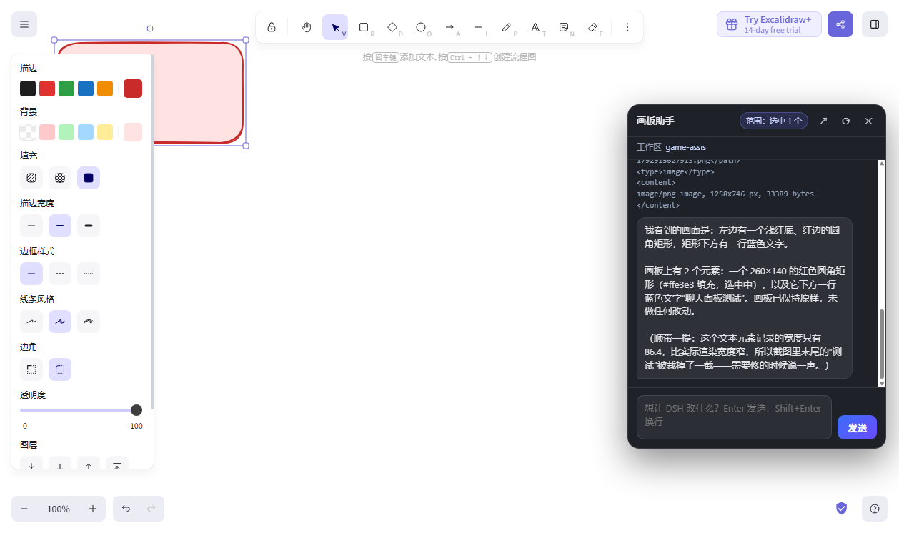
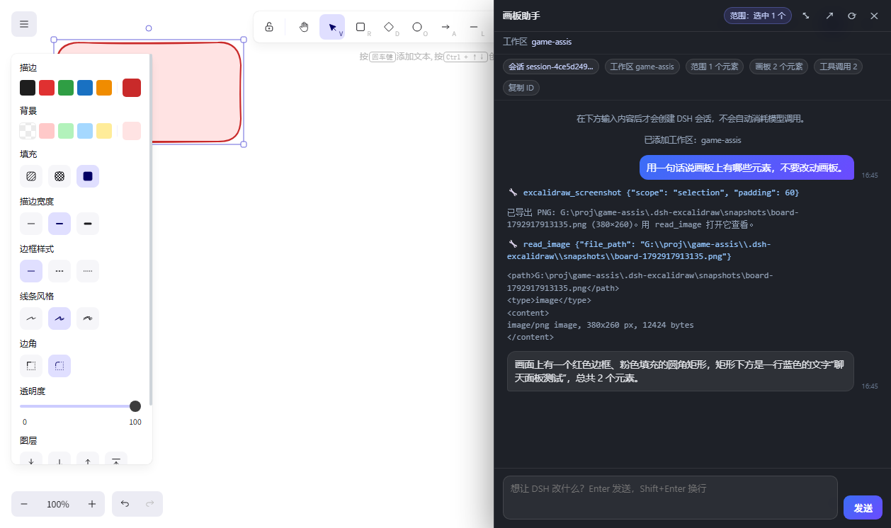

# Excalidraw × DSH 画板桥接

在 [excalidraw.com](https://excalidraw.com) 上点一下角落的按钮，右下角弹出一个小型对话面板 —— **DSH 静默在后台工作，聊天、看画板、改画板都在这块画布里完成**。想看得更清楚就点 **⤢** 把它展开成右侧全高侧边栏；想深入 DSH 查历史，再点「↗」。





- **不抢窗口**：默认不打开、不切换 DSH 窗口，DSH 只是一个本地后台服务；
- **点开不花钱**：打开面板不会创建会话、也不会触发模型调用；只有你按下第一次「发送」时才建会话；
- **工作区自由选**：既能选 DSH 里已有的工作区，也能在面板里输入任意目录路径注册成新工作区（记住上次选择）；
- **侧边栏视图**：**⤢** 展开成 560px 全高侧边栏，带会话信息条（会话 ID/工作区/范围/元素数/工具调用数、一键复制 ID）、完整时间戳、更宽的工具输出；
- **懂你画了什么**：第一次发送时把画板快照 + 当前选中范围注入会话；
- **能直接改画板**：会话里挂着 5 个实时画板工具（读场景、增删改、截图自查）；
- **范围可控**：修改默认限定在你点按钮时选中的元素上，范围外 id 会被拒绝；
- **随时回到 DSH**：面板「↗」可在 DSH 桌面窗口/新标签页打开同一个会话，看完整轨迹。

---

## 现在的状态

| 组件 | 位置 | 状态 |
| --- | --- | --- |
| DSH 插件 `dsh-excalidraw-bridge` | `plugin/`，已装进 desktop profile | 已生效（零依赖；设置 → 插件 里可开关） |
| Chrome 扩展 | `extension/` | 需手动「加载已解压的扩展程序」一次；改代码后点「重新加载」 |
| 本地桥接 | 插件进程内，`127.0.0.1:46231..46250` | 随插件启动 |

---

## 快速开始

### 1. 确认插件已启用

当前这台机器已经启用，通常无需操作。换机器/重装 DSH 时：设置 → 插件 → 启用 **Excalidraw Bridge**（或重启一次 DSH），会话工具列表里会出现 5 个 `excalidraw_*` 工具。

> 如果该行显示「失败」，点开关重试；插件不依赖任何 `@deepseek-ai/*` 包，失败信息会直接说明原因。

### 2. 加载/重载 Chrome 扩展

1. `chrome://extensions` → 打开右上角「开发者模式」；
2. 首次：点「加载已解压的扩展程序」→ 选 `G:\proj\game-assis\extension`；
3. 已加载过：点扩展卡片上的「重新加载」🔄（改了 page.js / content.js / background.js 后都要点）。

### 3. 在画板上对话

1. 打开/刷新 <https://excalidraw.com>，右下角出现 **「DSH 画板助手」**；
2. 点按钮只打开面板 —— **不会建会话、不会消耗模型调用**；
3. 想限定范围就先在画布上框选/点选元素；面板里会显示「范围：选中 N 个」；
4. 面板第二行选 **工作区**：下拉里是 DSH 已有的工作区；如果想要的目录不在列表里，选 **「＋ 添加目录作为工作区…」**，输入绝对路径（如 `G:\proj\my-project`）回车即可注册并选中（只影响之后创建的会话，选择会被记住）；
5. 输入第一句话并按发送：此时才创建 DSH 会话，并把画板快照 + 选中范围 + 这句话一起交给助手；
6. 之后就是普通聊天：Enter 发送、Shift+Enter 换行；
7. 面板头部：
   - **范围：整块画板 / 选中 N 个** —— 点它可以「用当前选中元素更新修改范围」；
   - **⤢ / ⤡** —— 展开为右侧全高侧边栏 / 收起为小窗（状态会记住）；
   - **↗** —— 在 DSH 里打开这个会话（打开后就能看完整轨迹、继续在 DSH 里聊）；
   - **⟳** —— 清空当前对话并准备新会话（旧会话仍留在 DSH 历史里；下次发送才创建）；
   - **✕** —— 收起面板（会话继续保留，点按钮恢复对话）。

**侧边栏视图**（⤢）额外显示：

- 会话信息条：会话 ID（点击「复制 ID」）、工作区、当前范围、画板元素数、工具调用次数；
- 消息时间戳、更宽的工具参数/输出（小窗里会被截断的内容，展开后显示更多）；
- 更大的输入框与更快扫读的排版。

---

## 工作原理

```text
excalidraw.com 标签页
├── page.js   (MAIN world, 扩展注入)
│     React fiber 找到 Excalidraw App 实例
│     api.getSceneElements / getAppState / updateScene / refresh / canvas 截图
│     ▲ postMessage                 │
│     ▼                             ▼
├── content.js (isolated, 扩展注入)
│     浮动按钮 + 聊天面板（shadow DOM）+ 轮询对话 + 收集画板上下文
│     ▲ chrome.runtime
│     ▼
├── background.js (MV3 service worker)
│     桥发现、长轮询页面操作、转发聊天请求
│     ▲ HTTP (127.0.0.1:46231..46250)
│     ▼
└── DSH 插件 dsh-excalidraw-bridge（Host 进程内，静默后台）
      ├─ /workspaces        列出已注册工作区
      ├─ /workspace/create  把任意目录注册成工作区（同路径复用）
      ├─ /start     首次发送时建会话 + 注入上下文 + 用户第一句（**不**打开窗口、不单独跑一轮）
      ├─ /message   追加一条用户消息
      ├─ /chat      长轮询会话日志 → 面板消息流（用户/助手/工具/错误；展开时可要更长的工具输出）
      ├─ /scope     更新该会话的修改范围
      ├─ /open      显式打开：把会话推给已连接的 DSH Web GUI
      ├─ /interrupt 停止当前轮
      └─ 工具：excalidraw_get_scene / apply / screenshot / select / status
```

几个关键设计：

**静默后台**：插件只跑在 DSH Host 进程里，不打开任何窗口；页面面板通过本地桥对话。`/open` 才会把一个 pending 事件推给 DSH Web GUI（`plugin/client.js` 长轮询 `/excalidraw/pending` 后用 `uiWorkspace.openSession` 切过去）；没有已连接 GUI 时扩展会打开带 token 的 DSH 地址兜底。

**懒创建**：打开面板只读画板 + 拉工作区列表，不建会话、不调用模型。第一次「发送」才调用 `/start`，把画板快照、选中范围和这句话合成**一条**用户消息，因此只跑一轮、没有额外的"打招呼"回合。

**工作区自选**：下拉来自 `/workspaces`（`workspaceRegistry` 里全部已注册工作区）；选「＋ 添加目录作为工作区…」可输入任意绝对路径，`/workspace/create` 会校验目录存在、同路径复用已有工作区、否则用 `workspaceRegistry.create()` 注册，然后立刻可用于建会话。选择存进 `chrome.storage.local`，会话创建后显示实际工作区名。

**侧边栏**：小窗 ↔ 全高侧边栏只是同一套 DOM 的两种尺寸（`panel.expanded`），展开时额外渲染会话信息条、时间戳，并向 `/chat` 请求更长的工具参数/输出；状态存 `sessionStorage`，刷新页面后保持。

**上下文注入**：`/start` 时把元素数组、选中 ids、视口、背景色压成结构化提示词（见 [docs/prompt-sample.md](docs/prompt-sample.md)）。模型会在同一轮里先读实时场景/截图，再执行你的要求。

**聊天流**：`/chat` 轮询 `sessionController.inspect()`，把提交后的会话事件投影成帧：用户消息、助手消息、工具调用/结果、错误；面板按帧渲染并显示「正在思考…」。目前是**按步提交**（不是逐 token 流式），工具执行过程会实时显示。

**范围约束**：会话绑定的 scope 在插件侧校验；`excalidraw_apply` 对 `update`/`delete` 的目标 id 做白名单，范围外直接报错并列出允许 id。模型要扩大范围必须显式传 `scope:"all"`。

**可撤销**：写入走 Excalidraw 官方 `updateScene({elements, captureUpdate:"IMMEDIATELY"})`，所以 DSH 的修改可以 Ctrl+Z 撤销。

**截图**：`excalidraw_screenshot` 把静态 canvas 合成为 PNG，保存到 `<会话工作区>/.dsh-excalidraw/snapshots/` 并返回路径，助手用 `read_image` 查看。Chrome 不绘制后台标签页，所以截图时扩展会把画板标签页短暂切到前台、截完再切回你原来的标签页。

---

## 画板工具

| 工具 | 作用 |
| --- | --- |
| `excalidraw_get_scene` | 读实时元素 / 选中项 / 视口。`scope:"selection"`（默认，只返回范围内的）或 `"all"` |
| `excalidraw_apply` | 元素操作数组：`add` / `update` / `delete`。默认拒绝范围外 id 的修改 |
| `excalidraw_screenshot` | 导出 PNG 到工作区并返回路径（`selection` 裁剪或 `viewport` 全屏） |
| `excalidraw_select` | 在页面上高亮选中指定元素，便于用户确认 |
| `excalidraw_status` | 桥接是否连通、当前页面与元素数 |

```json
[
  {"op":"add","element":{"type":"rectangle","x":100,"y":100,"width":200,"height":120,"strokeColor":"#1e1e1e"}},
  {"op":"update","id":"<元素id>","patch":{"backgroundColor":"#ffc9c9","fillStyle":"solid"}},
  {"op":"delete","ids":["<元素id>"]}
]
```

支持 `rectangle / ellipse / diamond / arrow / line / text / freedraw`；坐标是画板 scene 坐标。

---

## 已验证

| 验证项 | 结果 |
| --- | --- |
| `page.js` 在真实 excalidraw.com 上读元素、增删改、设置选中、导出 PNG | ✅ 无头 Chrome 实测 |
| 打开面板不建会话/不触发模型调用（只显示提示 + 工作区下拉） | ✅ 无头 Chrome + 真实插件 |
| 首次发送 → 懒创建会话（合并上下文+第一句）→ 助手按需读场景/截图并回答 | ✅ 同上，截图见上 |
| 工作区下拉列出 8 个真实工作区，创建后显示实际工作区（game-assis） | ✅ 同上 |
| 「＋ 添加目录作为工作区」：输入 `G:\proj\game-assis` → 复用已有工作区并选中；非法路径被拒绝 | ✅ 真实插件接口实测 |
| ⤢ 展开侧边栏：信息条（会话 ID/工作区/范围/元素数/工具调用）、时间戳、更宽工具输出 | ✅ 同上，截图见上 |
| 工具经「桥 → 扩展 → 页面」真实读画板（15 元素铁路信号图）、截屏、read_image | ✅ 真实页面实测 |
| 真实桌面 DSH 里插件激活、桥监听 46231、扩展已连接 | ✅ 当前会话实测 |
| 显式「在 DSH 打开」→ Web GUI 自动切到该会话 | ✅ 早前隔离实例验证（`docs/session-opened.png`） |
| 范围外修改被拒绝 | ✅ 之前版本实测（逻辑未变） |

> 修复记录：插件最初 `import '@deepseek-ai/dsh-tools'`。本地目录安装是 junction，插件实路径在工作区，Node 会从工作区向上解析而不是 DSH 安装目录 → 激活失败。现在插件内置等价的 `defineTool` 编译逻辑，**零外部依赖**。

---

## 配置

| 变量 | 作用 |
| --- | --- |
| `DSH_EXCALIDRAW_BRIDGE_PORT` | 桥接起始端口，默认 `46231`（顺序尝试 20 个，避开 Windows 保留端口） |
| `DSH_EXCALIDRAW_WORKSPACE` | 新会话固定的工作区路径；默认取当前默认工作区 |

- 扩展扫描 `46231..46250` 和兜底段 `47321..47330` 找桥；
- 提示词模板在 [`plugin/index.js`](plugin/index.js) 的 `buildPrompt()`；面板 UI 在 [`extension/content.js`](extension/content.js)。

---

## 故障排查

**面板显示「没找到 DSH 画板桥接服务」**

1. 设置 → 插件，确认 **Excalidraw Bridge** 启用；失败就点开关重试；
2. 桥只监听本机 `46231..46250`；被占用时改 `DSH_EXCALIDRAW_BRIDGE_PORT` 并同步改 `extension/background.js` 的 `PORTS`，重载扩展、重启 DSH；
3. 插件装好后需要重启一次 DSH 或切换一次插件开关才真正挂载。

**面板报「没有连接到 Excalidraw 页面」**

- 确认开着 excalidraw.com 且扩展启用；改过扩展代码后必须「重新加载」扩-展并刷新页面。

**面板一直显示「正在创建会话并注入画板上下文…」**

- Excalidraw 还在加载；等几秒刷新页面重试；
- 若 DSH 侧模型凭据有问题，面板会显示具体错误（例如 `MISSING_CREDENTIAL`）。

**会话跑到别的工作区了**

- 面板第二行的**工作区**只在「创建会话之前」可选；创建后显示实际工作区；
- 想换工作区：点 **⟳** 清空对话 → 选/添加工作区 → 再发第一句话。

**添加目录后没出现在下拉里**

- 路径必须是本机存在的绝对目录（Windows 用 `G:\proj\xxx` 这种写法）；
- 同一路径会复用已有工作区，不会重复添加；想加新目录直接选「＋ 添加目录作为工作区…」再输入；
- 失败原因会显示在面板消息区。

**侧边栏挡到画布**

- 点 **⤡** 收回小窗即可；展开状态会记住，刷新页面后仍保持。

**截图超时**

- Chrome 不给后台标签页绘制；扩展截图时会短暂切前台再切回；
- 仍超时就刷新页面（旧 page.js 在隐藏标签页会等 rAF）。

**面板不出现在右下角**

- 页面是否 `excalidraw.com`（自托管需改 `extension/manifest.json` 的 `matches` / `host_permissions`）；
- `chrome://extensions` 里扩展有没有报错。

---

## 安全与已知限制

- **桥只绑 127.0.0.1，但没有 token 校验**：本机任意程序（或网页 no-cors）都能调用 `/start` 建立会话；画板操作通道依赖扩展自己维持的轮询连接。单人本机开发够用，要收紧可以加一次性 token。
- `excalidraw.com` 持续发布，DOM/React fiber 结构变化可能让 App 探测失效；届时按钮会提示「还没找到 Excalidraw 应用实例」，需要按 [research/excalidraw-internals.md](research/excalidraw-internals.md) 更新探测逻辑。
- 聊天是**按步提交**而非逐 token 流式；工具执行过程实时可见。
- 复杂结构（绑定箭头、容器内文字、frame、图片、协同房间）只做基础修改，不自动维护绑定关系。
- 只匹配 `https://excalidraw.com/*`；自托管需改 manifest 后重载。
- Chrome 137+ 不支持命令行 `--load-extension`，必须手动加载解压扩展（自动化测试走 CDP `Extensions.loadUnpacked`）。
- 每次 `excalidraw_apply` 是独立 undo 步骤，没有批量事务回滚。

---

## 卸载

1. DSH 设置 → 插件 → 禁用/移除 Excalidraw Bridge（或从 profile 移除 bundle `dsh-excalidraw-bridge`）；
2. `chrome://extensions` → 移除扩展；
3. 可选：删除工作区 `.dsh-excalidraw/` 截图目录。

---

## 文件结构

```text
extension/                 Chrome MV3 扩展（需手动加载）
  manifest.json
  page.js                  MAIN world：Excalidraw App 探测 + 画板操作协议
  content.js               isolated：浮动按钮 / 聊天面板 / 范围读取 / 轮询对话
  background.js            桥发现、页面操作转发、聊天请求代理
  icons/
plugin/                    DSH Cordis 插件（已安装为 bundle）
  index.js                 桥 + 工具 + 工作区/会话/聊天/范围/打开 接口 + 提示词
  client.js                收到显式 /open 时在 DSH Web GUI 切到该会话
  package.json             dsh.bundle / dsh.client 清单
  cordis.patch.yml
  locale/ icon.svg
research/
  excalidraw-internals.md  调研：fiber 探测、localStorage、坐标换算、元素 schema
docs/
  chat-panel.png           小窗聊天面板截图
  sidebar-expanded.png     展开后的侧边栏（信息条/时间戳/完整工具输出）
  session-opened.png       显式「在 DSH 打开」时的会话视图
  prompt-sample.md         注入给模型的完整提示词样例
tools/                     仅开发调试用（不参与运行）
  mock-bridge.mjs          不启动 DSH 也能跑「桥 + 工具」
  cdp.mjs                  无头 Chrome 脚本执行器
  test-chat-panel.js       面板端到端测试
  test-extension-click.js  旧版点按钮流程测试
  test-page-protocol.js    页面协议测试
  asar.mjs                 读取 app.asar（研究用）
  make-icons.py            生成扩展图标
  load-extension-cdp.mjs   用 CDP 加载解压扩展
```
